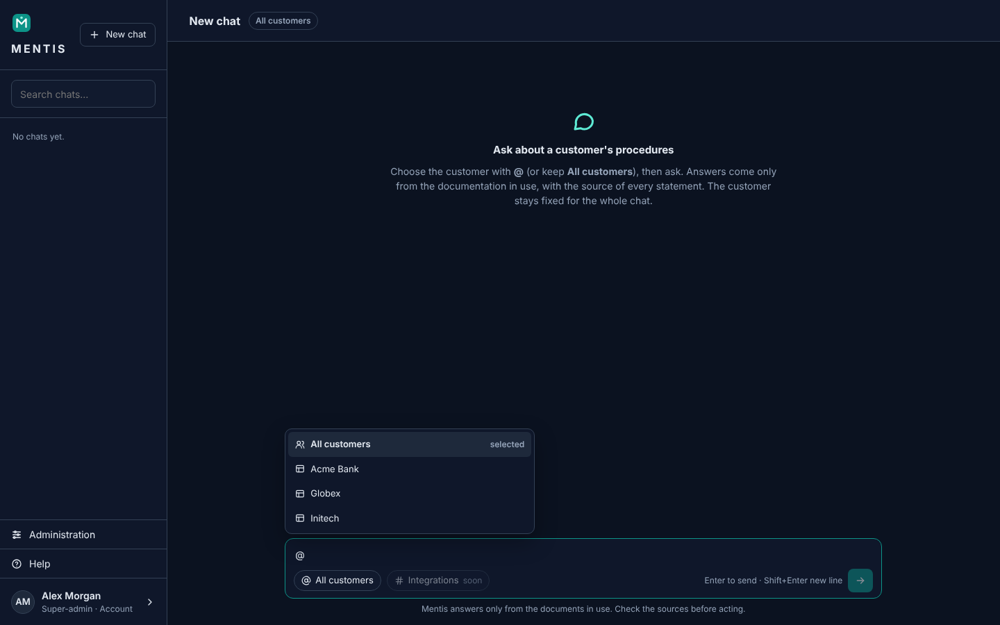
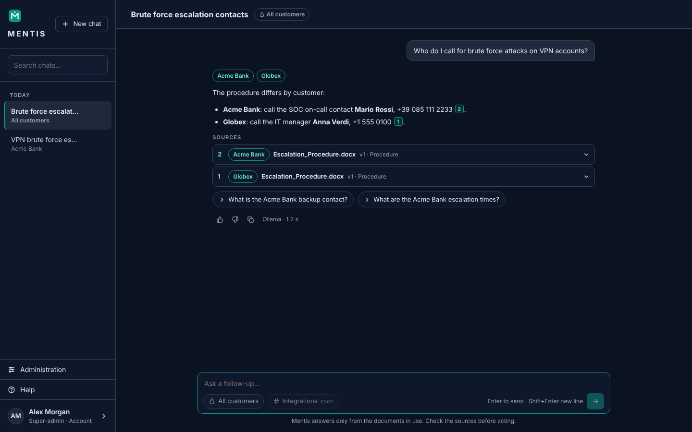
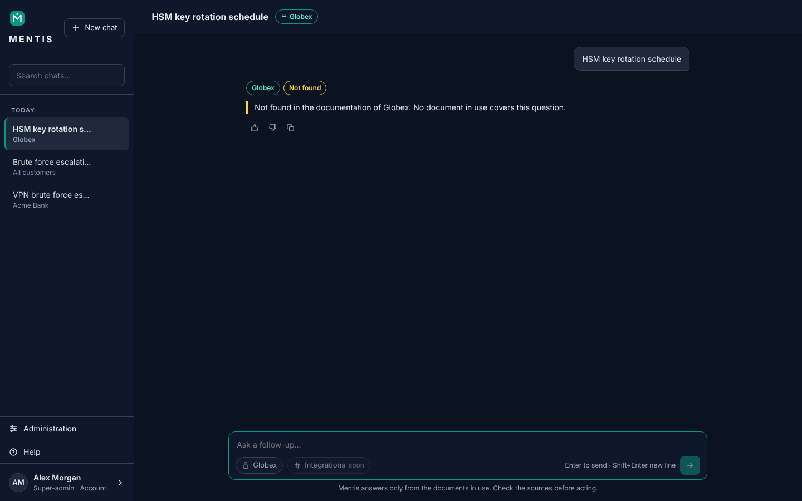
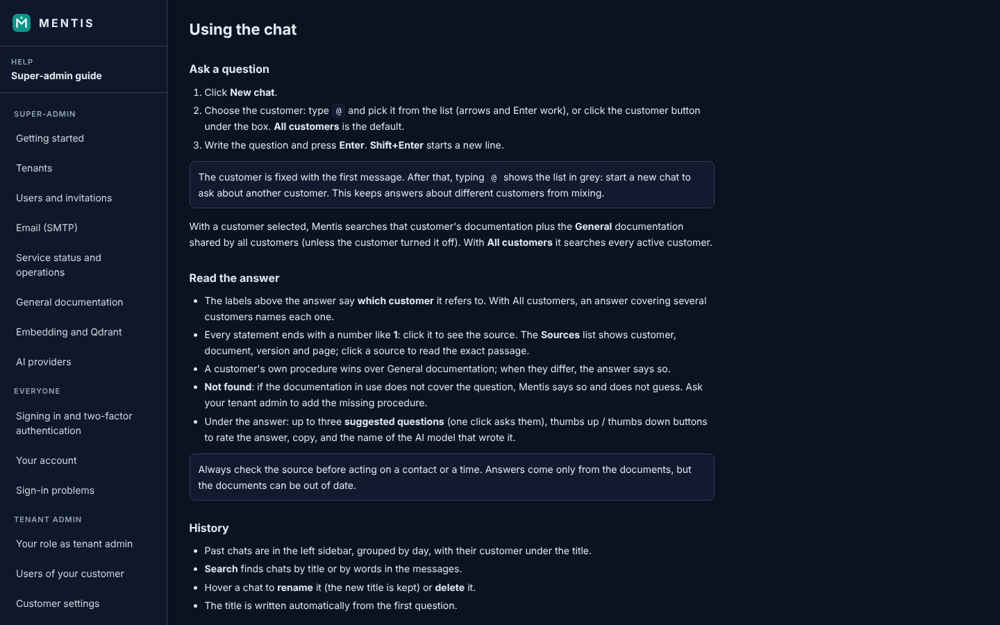
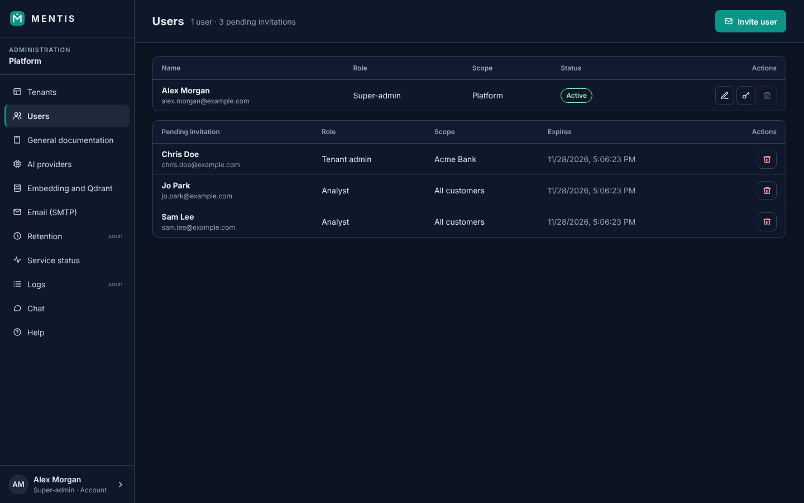
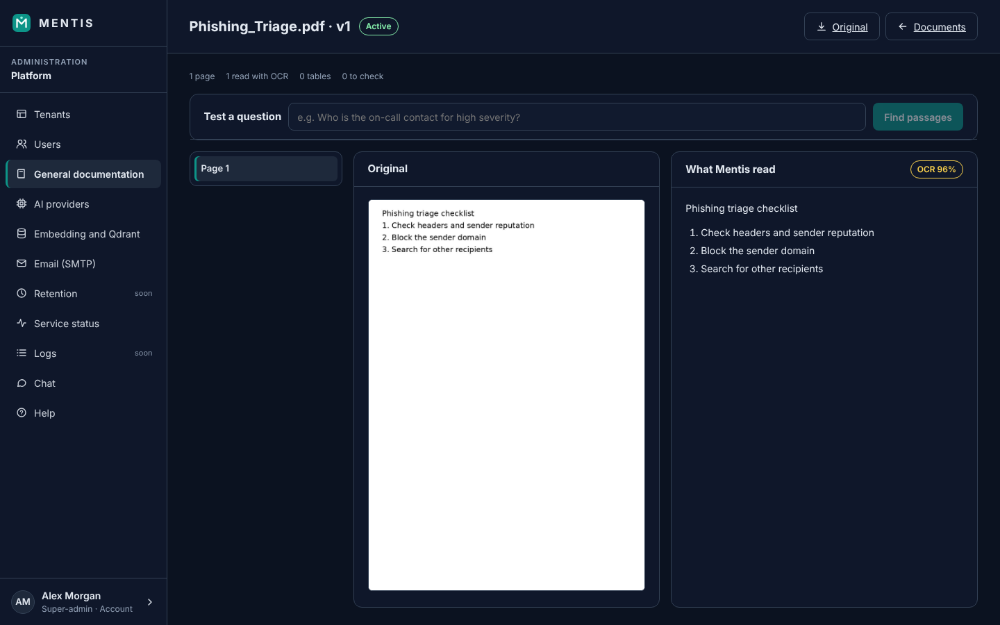
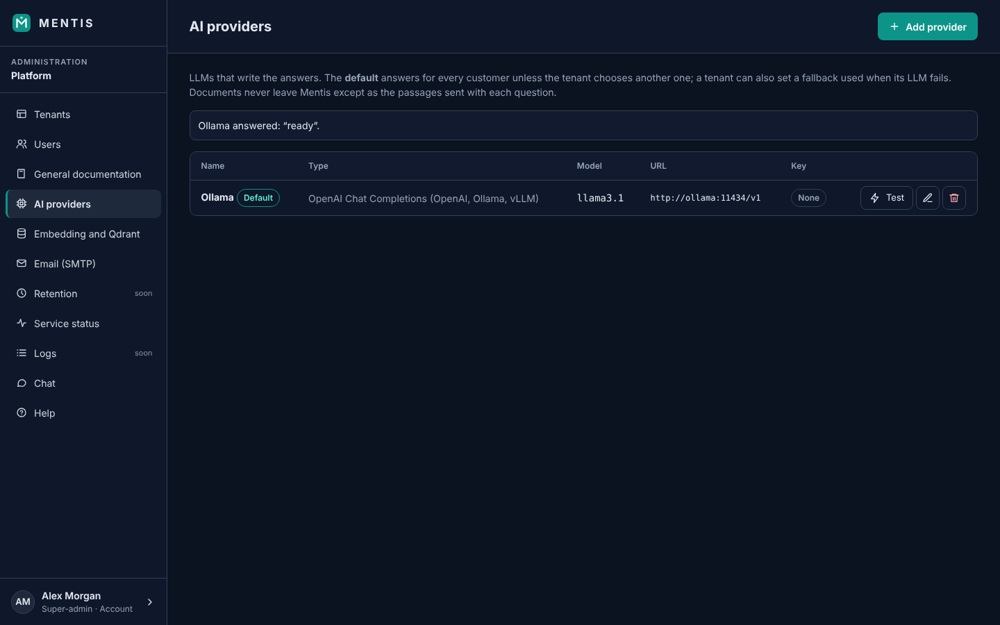
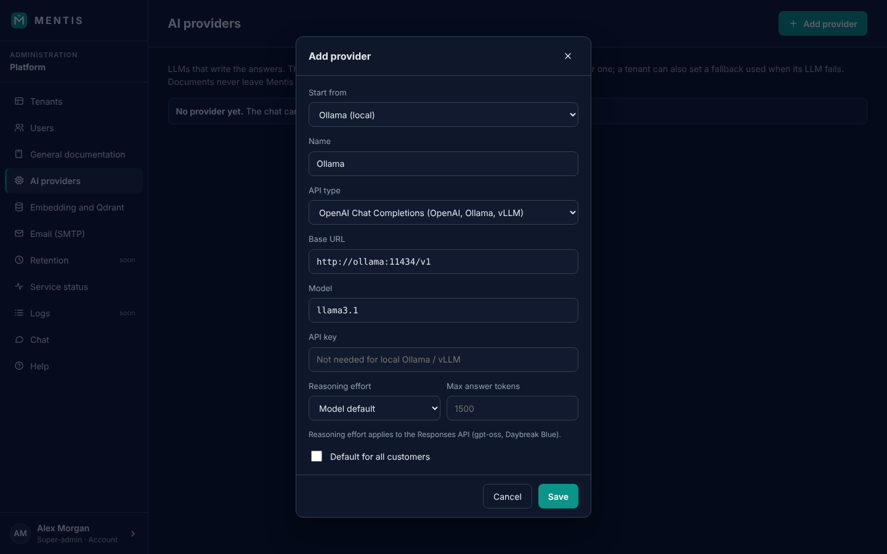
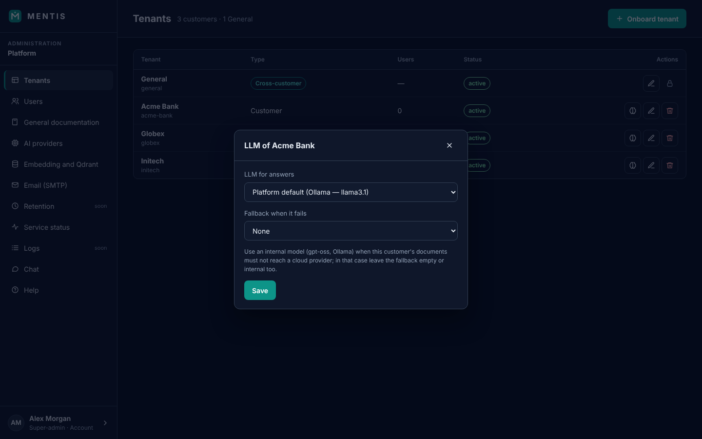

# Mentis

Mentis is a multi-tenant AI assistant for SOC analysts. It answers questions from each customer's own documentation (procedures, escalation matrices, runbooks) and cites its sources on every answer. Read-only integrations with the customer's ticketing, EDR and SIEM tools are planned.

> Status: pre-release (`0.1.0-alpha`), for lab use. See [CHANGELOG](CHANGELOG.md) and [release notes](docs/releases/).

## What it does

- **Chat**: pick the customer with `@` (or ask about all customers). Answers come only from the documents in use. Every statement cites its source (customer, document, version, page), and the chat says "Not found" instead of guessing. Suggested follow-ups, history, feedback.
- **One knowledge base per customer**, plus a **General** one shared by all. Tenant isolation is enforced server-side.
- **Documents**: PDF, Word, Excel, PowerPoint, with OCR for scans and images. Versions, approval before publishing, and a side-by-side preview of what Mentis read.
- **AI providers**: Claude, OpenAI, Daybreak Blue, gpt-oss (vLLM), Ollama. One LLM per customer with automatic fallback. Embeddings run locally (bge-m3), vectors are in Qdrant.
- **Security**: mandatory 2FA, three roles (super-admin, tenant admin, analyst), encrypted secrets, metadata-only logs.
- Light, Medium and Dark themes, plus in-app help for each profile.

## Screenshots

The screenshots use fictional demo data.

| | |
|---|---|
|  `@` chooses the customer |  After the first message the customer is locked |
|  All customers: one answer per customer |  Not covered by the documents: no guessing |
|  Follow-ups in the Light theme |  In-app help for each profile |
|  Tenants |  Users and invitations |
|  Documents and versions |  Preview: original next to what Mentis read |
|  Slides: tables and text in images |  AI providers |
|  Add a provider from a preset |  LLM and fallback for each customer |
|  Service status |  Account and themes |

## Documentation

- [INSTALL.md](INSTALL.md): installation with Docker Compose, reverse proxy, upgrade.
- [docs/MANUALS.md](docs/MANUALS.md): user and admin manuals (the same pages as the in-app Help).
- [docs/DESIGN.md](docs/DESIGN.md): design, decisions and roadmap.
